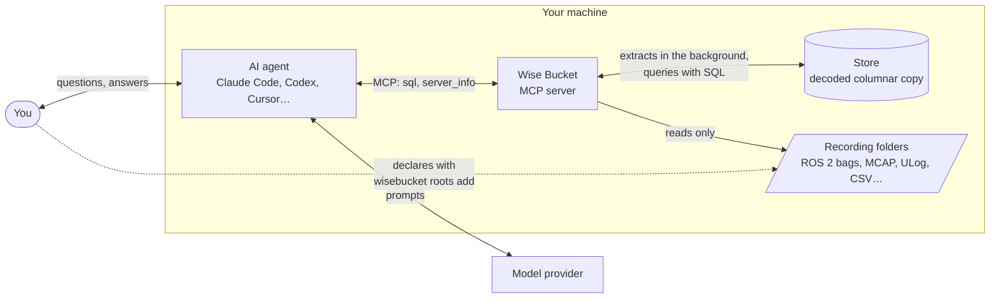

<div align="center">


**An open-source MCP server that gives R&D teams long-term context and insights on their time-series data.**

[](https://github.com/MBagory/wise-bucket/actions/workflows/ci.yml)
[](docs/guide.md)
[](LICENSE)
[](Cargo.toml)


[Overview](#overview) · [Getting started](#getting-started) · [Sample data](#try-it-with-sample-data) · [Everyday use](#everyday-use) · [Platforms](#platforms) · [Docs](#documentation) · [Contributing](#contributing)

</div>

## Overview

Wise Bucket connects your **AI agent** to the **time-series data on your machine**, so it can answer questions about your hardware (robots, drones, vehicles, test benches) from what was actually recorded.

It reads today:

- **Robotics:** ROS 2 bags (MCAP or SQLite `.db3`, including Humble bags), MCAP files
- **Drones:** PX4 ULog (`.ulg`)
- **Tables:** CSV, JSON Lines, Parquet, Arrow IPC

More formats are on the list of [possible features](docs/decisions/0014-possible-features-instead-of-milestones.md): CAN with DBC, ASAM MDF4, NI TDMS, HDF5, MAVLink, ArduPilot DataFlash, ROS 1 bags…

> [!WARNING]
> **Work in progress.** Wise Bucket is in early alpha. Commands, configuration and on-disk formats may change without notice. **There is no release yet**: the first one follows the testing of milestone M1 ([ADR 0015](docs/decisions/0015-first-release-after-m1.md)). Feedback and [issues](https://github.com/MBagory/wise-bucket/issues) are welcome.

### How it works



**Wise Bucket trades disk space for speed.** It reads each recording once and keeps a decoded, columnar copy of its signals: one table per stream (topic), with a common time column. Every question your agent asks then becomes a SQL query that reads only the columns and time range it needs, in milliseconds to seconds, instead of a new pass over your bags. Nothing is computed in advance: rates, gaps, windows, percentiles and joins between streams are written when a question needs them.

The copy is **derived**: delete it any time and it is rebuilt. Your recordings are never modified. New and changed files are extracted automatically while an agent session is open.

Your agent owns the model: **Wise Bucket never calls one**. It only reads the folders **you** declare, and the agent cannot add any. Why it is built this way: [decision records](docs/decisions/README.md).

## Getting started

### 1. Install

Prebuilt binaries come with the first release. Until then, build from source. You need [Rust](https://rustup.rs) 1.96 or newer, a C compiler, and `protoc` (the Protocol Buffers compiler):

```sh
xcode-select --install && brew install protobuf                      # macOS
sudo apt install build-essential protobuf-compiler                  # Debian, Ubuntu
sudo dnf install gcc protobuf-compiler                              # RHEL family, Fedora

cargo install --git https://github.com/MBagory/wise-bucket wisebucket --locked
```

The build takes several minutes. It installs `wisebucket` and its short alias `wbk` in `~/.cargo/bin`. To update, run the same command again.

### 2. Set up your machine (once)

```sh
wisebucket setup
```

`setup` only asks which folders hold your recordings. There is nothing to download and no database to install. Re-run it any time.

<details>
<summary>Example session</summary>

```text
$ wisebucket setup
Wise Bucket setup
✔ state directory: ~/.local/share/wisebucket
? Add a folder containing recordings (ROS 2 bags, MCAP, ULog, CSV…)? › yes
  Folder path › ~/robot-logs/bags
  Short name › bags
  Hardware these recordings come from (robot, vehicle…; optional) › rover-b
✔ root "bags" → /home/me/robot-logs/bags · 37 recording(s) (6 rosbag2 folders, 31 MCAP)
? Add another folder? › no
✔ configuration written to ~/.config/wisebucket/config.toml

Connect your agent (once, for all your folders). Claude Code:
claude mcp add --scope user wise-bucket -- /home/me/.cargo/bin/wisebucket serve
Other agents (Kilo Code, Cline, Cursor, …): add this to their global MCP settings:
{ "mcpServers": { "wise-bucket": { "command": "/home/me/.cargo/bin/wisebucket", "args": ["serve"] } } }
```

</details>

> [!TIP]
> **For scripts and CI:** `wisebucket setup --yes --root bags=~/robot-logs/bags`

### 3. Connect your agent (once)

Run the command `setup` printed at the end. Wise Bucket is registered for your user, so it works in every folder: there is nothing to do per repository.

| Agent | How to connect |
| --- | --- |
| **Claude Code** | `claude mcp add --scope user wise-bucket -- /home/me/.cargo/bin/wisebucket serve` |
| **Kilo Code, Cline, Cursor** | Add the JSON entry printed by `setup` to the agent's global MCP settings |
| **OpenAI Codex** | Add the entry to `~/.codex/config.toml` (below) |

```toml
# ~/.codex/config.toml
[mcp_servers.wise-bucket]
command = "/home/me/.cargo/bin/wisebucket"
args = ["serve"]
```

> [!NOTE]
> `setup` **only prints** these entries: it never edits your agent's settings. Re-run `setup` any time to see them again.

### 4. Talk to your agent

Start a new agent session, in any folder (in Claude Code, `/mcp` lists `wise-bucket`). The first session starts extracting your recordings in the background. Then ask:

```text
you   › Is Wise Bucket ready? What does it have?

agent › ⏺ wise-bucket · server_info
        Wise Bucket 0.1.0 is connected. Of the 37 recordings in bags
        (/home/me/robot-logs/bags, hardware rover-b), 30 are extracted
        and 7 are being extracted now.

you   › In the demo ULog, what is the accelerometer noise floor at rest?

agent › ⏺ wise-bucket · sql
          SELECT count(*), stddev("accelerometer_m_s2[2]"), avg("accelerometer_m_s2[2]")
          FROM stream('sensor_combined')
        Over 17,070 samples, the vertical acceleration averages −9.62 m/s²
        (gravity) with a standard deviation of 0.16 m/s²: that is the noise
        floor at rest.
```

<details>
<summary>When something isn't right, the answer tells you what to do</summary>

```text
you   › What happened in run7.mcap?

agent › ⏺ wise-bucket · sql
        run7.mcap could not be extracted: the file ends in the middle of a
        chunk (recording_unreadable). The recording itself is untouched; it is
        retried automatically if the file changes.
        Docs: https://github.com/MBagory/wise-bucket/blob/main/docs/reference/errors.md#recording_unreadable
```

</details>

## Try it with sample data

No recordings at hand? `demo` downloads small **public sample files**, one set per format, and declares them as a data root named `demo`:

```sh
wisebucket demo                 # pick formats from a list
wisebucket demo ros2-mcap ulog  # or name them
wisebucket demo --all           # everything (about 4 MB)
wisebucket demo --list          # formats, sizes and licenses
```

The files go to `<state dir>/demo/<format>/`. They are fetched from their upstream projects at a pinned commit and checked against a SHA-256, and they **stay under their own licenses** (Apache-2.0, MIT, BSD-3-Clause, LGPL-3.0): this repository does not include them. Re-running `demo` only downloads what is missing. Open an agent session and the readable ones are extracted within seconds. Remove them with `wisebucket roots remove demo` and by deleting the folder.

### Investigations to try

| Format | Sample | Ask your agent | Today? |
| --- | --- | --- | --- |
| *all* | everything you downloaded | *"Which recordings does Wise Bucket have in the demo root, and which could it read?"* | ✅ |
| `ros2-mcap` · `ros2-db3` | ROS 2 talker demo, 4.5 s: `/topic` (`std_msgs/String`) and `/rosout`, 10 messages each, as MCAP and as SQLite | *"Is `/topic` published at a steady rate?"* · *"Do the MCAP and SQLite copies hold the same messages?"* | ✅ |
| `mcap` | ROS 1-encoded demo (`/chatter`, `/diagnostics`) and an MCAP spec conformance file | *"Which topics are in `demo.mcap`, and at what rates?"* · *"Does the conformance file hold exactly ten messages?"* | ✅ timing and sizes (ROS 1 payloads are not decoded yet) |
| `ulog` | PX4 autopilot on the bench, disarmed, 69 s, no barometer detected | *"What is the IMU noise floor at rest?"* · *"When does CPU load peak, and what runs then?"* · *"Why is the barometric altitude flat?"* | ✅ |
| `parquet` | 8-row table covering the Parquet primitive types | *"Which column types does it hold?"* | ✅ |
| `ros1-bag` | demo bag plus one bag (`/chatter`, `/numbers`) stored uncompressed, LZ4 and BZ2 | *"Do the three compressions decode to the same `/numbers` sequence?"* | listed, not readable yet |
| `dataflash` | ArduPlane 3.8 software-in-the-loop log | *"How large is the roll tracking error?"* · *"Does battery voltage sag with current?"* | not yet |
| `tlog` | one MAVLink 2 `BATTERY_STATUS` followed by a truncated packet | *"What battery state was reported?"* | not yet |
| `can` | Vector ASC capture (20 frames, 9 IDs, 4 error frames), a BLF file, and an unrelated DBC | *"Which IDs are on the bus, and when do the error frames occur?"* | not yet |
| `mdf4` | MDF 4.10 file whose four channels have meaningless names | *"What do these channels measure?"* | not yet |

## Everyday use

### Commands

| You want to… | Run |
| --- | --- |
| Add a recording folder (a NAS mount works too) | `wisebucket roots add flights /Volumes/lab-nas/px4 --hardware drone-2` |
| See what your folders contain | `wisebucket roots check` |
| Query the store yourself, as your agent does | `wisebucket sql "SELECT status, count(*) FROM recordings GROUP BY status"` |
| Check that everything works | `wisebucket doctor` |
| See your settings and where each comes from | `wisebucket config show --origin` |
| Tab-complete commands in your shell | `wisebucket completions zsh > ~/.zfunc/_wisebucket` (also `bash`, `fish`) |

> [!IMPORTANT]
> Folder changes reach running agent sessions straight away. Your recordings are **never modified or moved**: the store holds a decoded copy, and `roots remove` only *forgets* a folder.

### Check your installation

`doctor` **checks everything** and links each problem to *its fix*:

<details>
<summary>Example output</summary>

```text
$ wisebucket doctor
✔ configuration      loaded (~/.config/wisebucket/config.toml)
✔ state directory    ~/.local/share/wisebucket · 84.6 GB free
✔ store              ~/.local/share/wisebucket/store · 1.2 GB · 36 done, 0 pending, 1 failed
⚠ extraction         1 recording(s) failed: `wisebucket sql "SELECT recording, error FROM recordings WHERE status = 'failed'"`
                     ↳ recording_unreadable · https://github.com/MBagory/wise-bucket/blob/main/docs/reference/errors.md#recording_unreadable
✔ sql                queries run
✔ data root          bags → /home/me/robot-logs/bags

6 check(s), 0 failed, 1 warning(s)
```

</details>

### Where your files are

| What | Where |
| --- | --- |
| Your settings and recording folders | Linux `~/.config/wisebucket/config.toml`, macOS `~/Library/Application Support/wisebucket/config.toml` |
| How your agent starts Wise Bucket | Your agent's user-level MCP settings (e.g. `claude mcp get wise-bucket`) |
| The store (decoded copy of your recordings) and logs | Linux `~/.local/share/wisebucket/`, macOS `~/Library/Application Support/wisebucket/` |

## Platforms

| Platform | Supported |
| --- | --- |
| macOS, Apple Silicon / Intel | ✅ |
| Linux x86_64 / arm64 | ✅ |
| Windows | through WSL2 |

## Documentation

- [User guide](docs/guide.md): install, setup, recording folders, connecting your agent, the store and SQL
- [Troubleshooting and FAQ](docs/troubleshooting.md)
- Reference: [Tables](docs/reference/tables.md) · [CLI](docs/reference/cli.md) · [Configuration](docs/reference/configuration.md) · [Errors](docs/reference/errors.md)
- [Decision records](docs/decisions/README.md): why Wise Bucket is built the way it is, and the possible features ahead
- [Security and privacy](SECURITY.md)

## Contributing

See [CONTRIBUTING.md](CONTRIBUTING.md) and the [Code of Conduct](CODE_OF_CONDUCT.md).

```sh
cargo build                          # needs a C compiler and protoc
cargo test --workspace
cargo run -p wisebucket -- docs gen   # regenerate reference pages after changing the CLI, errors, config or tables
cargo test -p wisebucket --test samples -- --ignored  # per-format sample checks (downloads ~4 MB once)
```

The acceptance tests drive **the real binary** through **a real MCP client**: background extraction, files added, changed and deleted during a session, two sessions at once, and the SQL lockdown. Format tests extract generated fixtures with exact expected values.

## Security

**Recordings and the store stay on your machine.** The agent's SQL is read-only and sees only the store. Downloads (`demo`) are *pinned and verified*. What your agent sends to its own model follows your agent's terms. Report vulnerabilities **privately**: see [SECURITY.md](SECURITY.md).

## License

[Apache License 2.0](LICENSE). Built on [Apache DataFusion](https://datafusion.apache.org), [Lance](https://github.com/lance-format/lance), [Apache Arrow](https://arrow.apache.org), the [Rust MCP SDK](https://github.com/modelcontextprotocol/rust-sdk), [mcap](https://github.com/foxglove/mcap), Rerun's [re_ros_msg](https://github.com/rerun-io/rerun), [px4-ulog](https://github.com/PX4/px4-ulog-rs) and [SQLite](https://sqlite.org). Bundled ROS 2 message definitions come from [ros2/common_interfaces](https://github.com/ros2/common_interfaces) and related repositories (Apache-2.0, BSD-3-Clause). To cite Wise Bucket, use [CITATION.cff](CITATION.cff).
