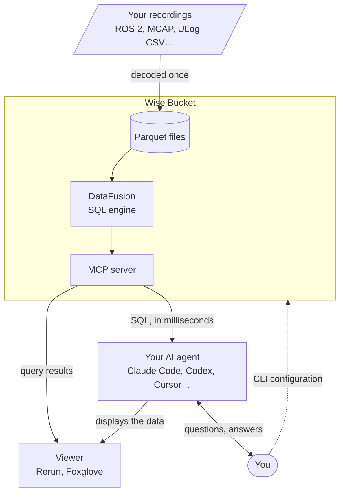

<div align="center">


[](https://github.com/MBagory/wise-bucket/actions/workflows/ci.yml)
[](docs/guide.md)
[](LICENSE)
[](Cargo.toml)


[Getting started](#getting-started) · [Sample data](#try-it-with-sample-data) · [Everyday use](#everyday-use) · [Docs](#documentation)

</div>

**Your AI agent queries every recording on your machine with SQL.**
ROS 2 bags (MCAP or `.db3`), MCAP (ROS 2, protobuf, JSON), PX4 ULog, MAVLink `.tlog`, ArduPilot DataFlash, Vector CAN logs (ASC, BLF) with your DBC files, NMEA 0183 and NMEA 2000, MDF4, CSV, JSON Lines, Parquet and Arrow IPC.

## ⚡ Fast

Each recording is decoded once into Parquet files. Every question after that is a SQL query run by [Apache DataFusion](https://datafusion.apache.org), reading only the columns and time range it needs: answers across all your recordings in milliseconds, not a new pass over your bags.

## 🪶 Frugal

Everything your agent reads fills its context, and a fuller context makes it slower, costlier and less accurate. The SQL runs on your machine and only the answer comes back; full-resolution signals go straight to your viewer.

## 🤖 Bring your own agent

Wise Bucket is an MCP server for the agent you already use (Claude Code, Codex, Cursor…), with its model and your subscription. No extra API key, and your files stay on your machine: only the query results your agent reads reach its model.

## 🎯 Faithful

Never worse than your agent alone: your raw files stay where they are, and your agent can still read them with its own tools. [`evals/crosscheck.sh`](https://github.com/MBagory/wise-bucket/blob/develop/evals/crosscheck.sh) checks it by asking an agent the same questions twice, once from the raw files alone and once only through Wise Bucket; whatever Wise Bucket missed becomes a fix.

## 📈 Works with your viewer

Your agent opens the original recording at the right moment in [Rerun or Foxglove](docs/guide.md#viewers), through the viewer's MCP server. It also sends any query result straight to Rerun at full resolution, without passing through its context.

## Compared with your agent alone

| | Agent alone | Agent with Wise Bucket |
| --- | --- | --- |
| Each question | a parsing script over the raw files | one SQL query |
| Its context fills with | script output, tracebacks, retries | the answer |
| Across recordings | one file at a time | all at once |
| Plots | arrays or plotting code | full resolution in Rerun |

## Also

- ✔️ **Checked decoding:** each format is compared with its reference decoder (python-can, pyulog, pymavlink, pynmea2, canboat, asammdf) on public sample recordings.
- 📝 **[Long-term context](docs/guide.md#what-you-know-about-recordings):** tell your agent what the files don't say (the machine, what changed, the test conditions); Wise Bucket keeps it for every later session.
- 🔍 **[Abnormal and similar recordings](docs/guide.md#abnormal-and-similar-recordings):** your agent scores each recording against its peers of the same machine.
- 📋 **Notes** on each recording: the errors and warnings it logged, gaps, and what wasn't decoded.

## How it works



Written in Rust, on [Apache DataFusion](https://datafusion.apache.org) and [Apache Parquet](https://parquet.apache.org).

> [!WARNING]
> **Early alpha.** Commands and on-disk formats may change. [Issues](https://github.com/MBagory/wise-bucket/issues) welcome.

## Getting started

**1. Install** on macOS or Linux:

```sh
curl --proto '=https' --tlsv1.2 -LsSf https://github.com/MBagory/wise-bucket/releases/latest/download/wisebucket-installer.sh | sh
```

Then open a new terminal. To update, run it again. To build from source instead, see the [guide](docs/guide.md#build-from-source).

**2. Set up** (once): `wisebucket setup` asks which folders hold your recordings.

**3. Connect your agent** (once) with the command `setup` prints. Claude Code:

```sh
claude mcp add --scope user wise-bucket -- ~/.cargo/bin/wisebucket serve
```

Other agents (Codex, Cursor, Cline…): see [Connect your agent](docs/guide.md#connect-your-agent).

**4. Ask**, in a new agent session:

```text
you   › In the demo ULog, what is the accelerometer noise floor at rest?

agent › ⏺ wise-bucket · sql
          SELECT count(*), stddev("accelerometer_m_s2[2]"), avg("accelerometer_m_s2[2]")
          FROM stream('sensor_combined')
        Over 17,070 samples, the vertical acceleration averages −9.62 m/s²
        (gravity) with a standard deviation of 0.16 m/s²: that is the noise
        floor at rest.

you   › Show me the three accelerometer axes in Rerun.

agent › ⏺ wise-bucket · rerun  (entity: sensor_combined)
          SELECT t, "accelerometer_m_s2[0]" AS x, "accelerometer_m_s2[1]" AS y,
                 "accelerometer_m_s2[2]" AS z
          FROM stream('sensor_combined')
        Sent 17,070 rows to the Rerun viewer: sensor_combined/x, y and z,
        on the timeline t.
```

The Rerun viewer must be running (`rerun`). Wise Bucket sends the rows to it directly; they do not pass through your agent.

## Try it with sample data

```sh
wisebucket demo --all     # about 4 MB of public samples, declared as the `demo` folder
wisebucket demo --list    # formats, sizes and licenses
```

Samples are fetched from their upstream projects at pinned commits, SHA-256-verified, and stay under their own licenses. Then ask your agent:

| Sample | Ask |
| --- | --- |
| `ros2-mcap` · `ros2-db3` | *"Is `/topic` published at a steady rate?"* |
| `ulog` | *"When does CPU load peak, and what runs then?"* · *"Why is the barometric altitude flat?"* · *"Which parameters differ from their defaults?"* |
| `tlog` | *"What battery state was reported?"* |
| `dataflash` | *"How far did the attitude lag the demand?"* · *"Which parameters were set?"* |
| `nmea0183` | *"What was the speed over ground, and how many satellites?"* |
| `nmea2000` | *"How did the apparent wind change during the tack?"* |
| `mdf4` | *"What range does each channel cover?"* |
| `can` | *"Which CAN IDs are on the bus, at what rate?"* · *"When did error frames occur?"* |
| `parquet` | *"Which column types does it hold?"* |

## Everyday use

| You want to… | Run |
| --- | --- |
| Add a recording folder | `wisebucket roots add flights /Volumes/lab-nas/px4` |
| Tell what the files don't say | `wisebucket note flights: hardware=drone-2`, or just tell your agent |
| Query the store as your agent does | `wisebucket sql "SELECT status, count(*) FROM recordings GROUP BY status"` |
| Check that everything works | `wisebucket doctor` |

Runs on macOS and Linux; Windows through WSL2.

## Documentation

[User guide](docs/guide.md) · [Troubleshooting and FAQ](docs/troubleshooting.md) · Reference: [tables](docs/reference/tables.md), [CLI](docs/reference/cli.md), [configuration](docs/reference/configuration.md), [errors](docs/reference/errors.md) · [Security and privacy](SECURITY.md) · [Contributing](CONTRIBUTING.md)

## License

[Apache License 2.0](LICENSE). Built on [Apache DataFusion](https://datafusion.apache.org), [Apache Parquet](https://parquet.apache.org), [Apache Arrow](https://arrow.apache.org), the [Rust MCP SDK](https://github.com/modelcontextprotocol/rust-sdk), [mcap](https://github.com/foxglove/mcap), Rerun's [re_ros_msg](https://github.com/rerun-io/rerun), [px4-ulog](https://github.com/PX4/px4-ulog-rs), [rust-mavlink](https://github.com/mavlink/rust-mavlink) and [SQLite](https://sqlite.org). Bundled ROS 2 message definitions come from [ros2/common_interfaces](https://github.com/ros2/common_interfaces) and related repositories (Apache-2.0, BSD-3-Clause). To cite Wise Bucket, use [CITATION.cff](CITATION.cff).
