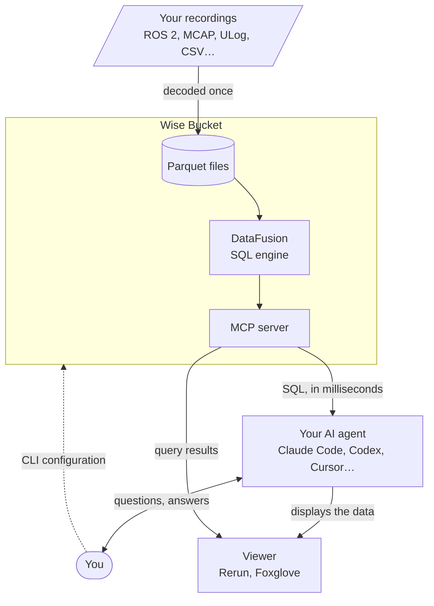

<div align="center">


**An open-source MCP server that gives R&D teams long-term context and insights on their time-series data.**

[](https://github.com/MBagory/wise-bucket/actions/workflows/ci.yml)
[](docs/guide.md)
[](LICENSE)
[](Cargo.toml)


[Overview](#overview) · [Getting started](#getting-started) · [Sample data](#try-it-with-sample-data) · [Everyday use](#everyday-use) · [Docs](#documentation)

</div>

## Overview

Wise Bucket connects your **AI agent** to **your time-series data** (telemetry, logs, measurements, etc.) on your machine. It reads ROS 2 bags (MCAP or `.db3`), MCAP, PX4 ULog, MAVLink `.tlog`, CSV, JSON Lines, Parquet and Arrow IPC.

> [!WARNING]
> **Early alpha, no release yet.** Commands and on-disk formats may change. [Issues](https://github.com/MBagory/wise-bucket/issues) welcome.

### ⚡ Built for speed

Written in Rust, on [Apache DataFusion](https://datafusion.apache.org) and [Apache Parquet](https://parquet.apache.org). Each recording is decoded once into Parquet files, and your agent queries them with SQL through DataFusion: answers across all your recordings, in milliseconds.

### 🤖 Bring your own agent

Use the agent you already work with (Claude Code, Codex, Cursor…), with its model and your subscription. It finds abnormal and similar recordings by comparing each one with its peers.

### 📈 Display data in a compatible viewer

Your agent plots any signal instantly, sends any query result to [Rerun](https://rerun.io), and works with [viewer MCP servers](docs/guide.md#viewers) (Rerun, Foxglove) to show a recording at the right time.

### 🔭 Tomorrow

Store investigation context, and search all your recordings for similar behaviour and anomalies.



## Getting started

**1. Install** from source: you need [Rust](https://rustup.rs) 1.96+ and a C compiler.

```sh
xcode-select --install                                  # macOS
sudo apt install build-essential                        # Debian, Ubuntu
cargo install --git https://github.com/MBagory/wise-bucket wisebucket --locked
```

**2. Set up** (once): `wisebucket setup` asks which folders hold your recordings.

**3. Connect your agent** (once) with the command `setup` prints. Claude Code:

```sh
claude mcp add --scope user wise-bucket -- ~/.cargo/bin/wisebucket serve
```

Other agents (Codex, Cursor, Cline…): see [Connect your agent](docs/guide.md#connect-your-agent).

**4. Ask**, in a new agent session:

```text
you   › In the demo ULog, what is the accelerometer noise floor at rest?

agent › ⏺ wise-bucket · sql
          SELECT count(*), stddev("accelerometer_m_s2[2]"), avg("accelerometer_m_s2[2]")
          FROM stream('sensor_combined')
        Over 17,070 samples, the vertical acceleration averages −9.62 m/s²
        (gravity) with a standard deviation of 0.16 m/s²: that is the noise
        floor at rest.

you   › Show me the three accelerometer axes in Rerun.

agent › ⏺ wise-bucket · rerun  (entity: sensor_combined)
          SELECT t, "accelerometer_m_s2[0]" AS x, "accelerometer_m_s2[1]" AS y,
                 "accelerometer_m_s2[2]" AS z
          FROM stream('sensor_combined')
        Sent 17,070 rows to the Rerun viewer: sensor_combined/x, y and z,
        on the timeline t.
```

The Rerun viewer must be running (`rerun`). Wise Bucket sends the rows to it directly; they do not pass through your agent.

## Try it with sample data

```sh
wisebucket demo --all     # about 4 MB of public samples, declared as the `demo` folder
wisebucket demo --list    # formats, sizes and licenses
```

Samples are fetched from their upstream projects at pinned commits, SHA-256-verified, and stay under their own licenses. Then ask your agent:

| Sample | Ask |
| --- | --- |
| `ros2-mcap` · `ros2-db3` | *"Is `/topic` published at a steady rate?"* |
| `ulog` | *"When does CPU load peak, and what runs then?"* · *"Why is the barometric altitude flat?"* · *"Which parameters differ from their defaults?"* |
| `tlog` | *"What battery state was reported?"* |
| `parquet` | *"Which column types does it hold?"* |

## Everyday use

| You want to… | Run |
| --- | --- |
| Add a recording folder | `wisebucket roots add flights /Volumes/lab-nas/px4` |
| Tell what the files don't say | `wisebucket note flights: hardware=drone-2`, or just tell your agent |
| Query the store as your agent does | `wisebucket sql "SELECT status, count(*) FROM recordings GROUP BY status"` |
| Check that everything works | `wisebucket doctor` |

Runs on macOS and Linux; Windows through WSL2.

## Documentation

[User guide](docs/guide.md) · [Troubleshooting and FAQ](docs/troubleshooting.md) · Reference: [tables](docs/reference/tables.md), [CLI](docs/reference/cli.md), [configuration](docs/reference/configuration.md), [errors](docs/reference/errors.md) · [Security and privacy](SECURITY.md) · [Contributing](CONTRIBUTING.md)

## License

[Apache License 2.0](LICENSE). Built on [Apache DataFusion](https://datafusion.apache.org), [Apache Parquet](https://parquet.apache.org), [Apache Arrow](https://arrow.apache.org), the [Rust MCP SDK](https://github.com/modelcontextprotocol/rust-sdk), [mcap](https://github.com/foxglove/mcap), Rerun's [re_ros_msg](https://github.com/rerun-io/rerun), [px4-ulog](https://github.com/PX4/px4-ulog-rs), [rust-mavlink](https://github.com/mavlink/rust-mavlink) and [SQLite](https://sqlite.org). Bundled ROS 2 message definitions come from [ros2/common_interfaces](https://github.com/ros2/common_interfaces) and related repositories (Apache-2.0, BSD-3-Clause). To cite Wise Bucket, use [CITATION.cff](CITATION.cff).
